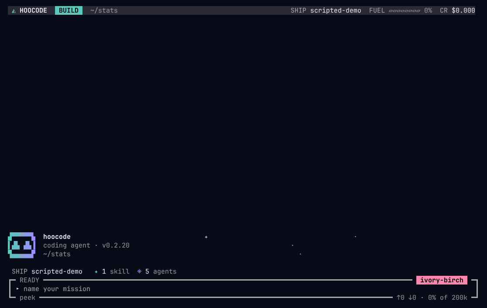

<p align="center">
  <picture>
    <source media="(prefers-color-scheme: dark)" srcset="docs/assets/brand/hoocode.svg">
    <source media="(prefers-color-scheme: light)" srcset="docs/assets/brand/hoocode-light.svg">
    
  </picture>
</p>

<p align="center">A terminal coding agent, written in Rust. One static binary, any model provider, nothing applied without your say-so.</p>

<p align="center">
  <a href="https://github.com/kolisachint/hoocode/actions/workflows/ci.yml"></a>
  <a href="https://github.com/kolisachint/hoocode/releases/latest"></a>
  <a href="https://www.npmjs.com/package/hoocode"></a>
  <a href="https://pypi.org/project/hoocode/"></a>
  <a href="LICENSE"></a>
</p>

<p align="center">
  
</p>

<p align="center"><sub>The real binary; only the model is scripted, so the demo can be recorded again for each release (<code>scripts/demo/record.sh</code>).</sub></p>

---

hoocode reads your code, runs commands, edits files and talks to the model of your
choice, from a full-screen terminal UI or as a one-shot command. It is a single native
binary: no Node, no Python, no runtime to install.

- **Any provider.** Anthropic, OpenAI, Google, OpenRouter, Groq, DeepSeek, xAI, Fireworks
  and more, by API key or by `/login` (Anthropic, GitHub Copilot, OpenAI Codex, Google).
- **You stay in control.** Shell, Edit and Write ask first (Yes / No / Always). Four
  agent modes (ask, plan, build, debug) scope what the agent may do.
- **Subagents.** The agent can hand work to background subagents and keep going; their
  tool calls go through the same approval gate as the main agent.
- **Sessions you can come back to.** `--continue`, `/resume`, `/fork`, `/tree`, and
  automatic compaction of long conversations.
- **Extensible with open formats.** `AGENTS.md` / `CLAUDE.md` context files, skills,
  prompt templates and slash commands, MCP servers, plugins, themes and keybindings.
- **Scriptable.** Print mode (`-p`) with text or JSON output, and a JSON-RPC mode
  (`--mode rpc`) for driving hoocode from another program.

## Install

hoocode runs on **macOS and Linux, on x64 and arm64**. The Linux builds are static
(musl), so one binary runs on any distro. There is no Windows build yet.

**Install script** (no root, no Node):

```bash
curl -fsSL https://kolisachint.github.io/hoocode/install.sh | sh
```

It downloads the release archive for your platform, checks it against the release's
`SHA256SUMS`, installs `~/.hoocode/bin/hoocode` (plus a `hoo` alias) and adds
`~/.hoocode/bin` to your `PATH`. Pass `--help` for the options (`--version`, `--dir`,
`--no-modify-path`). The script is [`install/install.sh`](install/install.sh) in this repo.

**npm or bun** (Node 18 or newer):

```bash
npm install -g hoocode     # or: bun add -g hoocode
```

The package pulls in only the native binary for your platform. It installs `hoocode`
and `hoo`.

**pip** (Python 3.8 or newer):

```bash
pip install hoocode        # or: pipx install hoocode
```

A thin launcher: on first run it downloads the release binary for your platform,
checks its sha256 against `SHA256SUMS` and caches it under `~/.cache/hoocode/`.

**Prebuilt binaries.** Every [GitHub release](https://github.com/kolisachint/hoocode/releases)
has `hoocode-<target>.tar.gz` for `x86_64-unknown-linux-musl`,
`aarch64-unknown-linux-musl`, `x86_64-apple-darwin` and `aarch64-apple-darwin`, and a
`SHA256SUMS` file. Unpack it and put `hoocode` on your `PATH`:

```bash
tar xzf hoocode-aarch64-apple-darwin.tar.gz
install -m 755 hoocode-aarch64-apple-darwin/hoocode ~/.local/bin/hoocode
```

**From source** (Rust 1.88 or newer; the repo pins its dev toolchain in
[`rust-toolchain.toml`](rust-toolchain.toml), which rustup picks up by itself):

```bash
git clone https://github.com/kolisachint/hoocode
cd hoocode
cargo install --locked --path crates/hoocode-code-main --bin hoocode
```

Or run `scripts/install.sh`, which builds a release binary and installs it as
`hoocode` and `hoo` into `~/.hoocode/bin` (if the install script was used before) or
`~/.local/bin`. `--prefix DIR` picks another directory.

hoocode is not on crates.io or Homebrew.

**Updating.** `hoocode update` prints the right update command for how you installed it.

## Quick start

```bash
export ANTHROPIC_API_KEY=...          # or any provider key, see `hoocode --help`
cd your-project
hoocode                               # full-screen interactive session
```

No API key? Start `hoocode` and run `/login` to sign in with a subscription instead.

A few things to try in the interactive session:

| Type | What it does |
|---|---|
| `/model` | Pick a model (Ctrl+P cycles through your favourites) |
| `/mode` | Switch between ask, plan, build and debug |
| `/resume` | Reopen an earlier session in this folder |
| `@path/to/file` | Attach a file to your message |
| `/hotkeys` | Show the keyboard shortcuts |
| `/settings` | Change settings |

One-shot and scripted use:

```bash
hoocode -p "Summarize this repo"                        # print the answer and exit
hoocode -p --mode json "List the TODOs in src/"         # JSON event stream
hoocode --model anthropic/claude-sonnet-4-5 "Review the last commit"
hoocode --continue "And now fix the first one"          # continue the last session
hoocode --tools Read,CodeSearch -p "Review src/"        # read-only run
hoocode --mode rpc                                      # JSON-RPC over stdin/stdout
```

Plugins add skills, subagents and MCP servers. Add a git marketplace, then install
from it, from the shell or with `/plugin` in a session:

```bash
hoocode plugin marketplace add <git-url-or-owner/repo>
hoocode install <plugin>@<marketplace>     # --scope project for this repo only
hoocode list
```

`hoocode --help` lists every flag and the provider environment variables;
`hoocode --list-models [search]` lists the models it knows.

## Configuration

Everything hoocode keeps lives in **`~/.hoocode`**. Set `HOOCODE_CODING_AGENT_DIR` to
move it.

| File or folder | What it holds |
|---|---|
| `~/.hoocode/settings.json` | Global settings (`/settings` edits it) |
| `.hoocode/settings.json` | Per-project settings, merged over the global ones |
| `~/.hoocode/auth.json` | Logins and keys saved by `/login` |
| `~/.hoocode/models.json` | Your own providers and models (for example a local OpenAI-compatible server) |
| `~/.hoocode/hoo-config.json` | Agent modes and tool approval rules (`auto_allow`) |
| `~/.hoocode/skills/`, `.hoocode/skills/` | Skills, global and per project |
| `~/.hoocode/themes/` | Custom themes |
| `~/.hoocode/sessions/` | Saved sessions, one JSONL file each, in a folder per project (`HOOCODE_CODING_AGENT_SESSION_DIR` or `--session-dir` moves them) |
| `~/.agents/mcp.json`, `.agents/mcp.json` | MCP servers, global and per project (`/mcp` shows their state) |
| `~/.agents/plugins/`, `.agents/plugins/` | Plugins, user and per project (`hoocode install`, `hoocode list`, or `/plugin` in a session) |
| `AGENTS.md` or `CLAUDE.md` | Project instructions, read from the working folder and its parents |

Because sessions are saved as files, you can resume, fork or export
them (`/export <file>.jsonl`). `--no-session` keeps a run ephemeral, and `--offline`
turns off startup network calls such as the version check.

## Documentation

- [`docs/maps/ui.md`](docs/maps/ui.md): the screen, pickers, slash commands and keys,
  and where each lives in the code
- [`docs/maps/packages.md`](docs/maps/packages.md): every crate in the workspace and
  what it does
- [`docs/design/`](docs/design/README.md): design notes and the plan for what is built next
- [`docs/design/distribution.md`](docs/design/distribution.md): how releases reach users
- [`CHANGELOG.md`](CHANGELOG.md): what changed (also `/changelog` inside hoocode)

## Contributing

Bug reports, ideas and pull requests are welcome. Start with
[CONTRIBUTING.md](CONTRIBUTING.md): it covers the dev loop (fmt, clippy, nextest),
where tests go and how releases work. Please read the
[code of conduct](CODE_OF_CONDUCT.md), and report security problems privately as
described in [SECURITY.md](SECURITY.md).

If hoocode is useful to you, a star on the repo helps other people find it.

## Credits

hoocode began as a fork of [`pi-mono`](https://github.com/badlogic/pi-mono) by
Mario Zechner, which is MIT-licensed. Its copyright notice is kept in [LICENSE](LICENSE).
Thanks to Mario and the upstream contributors.

## License

MIT, see [LICENSE](LICENSE).
